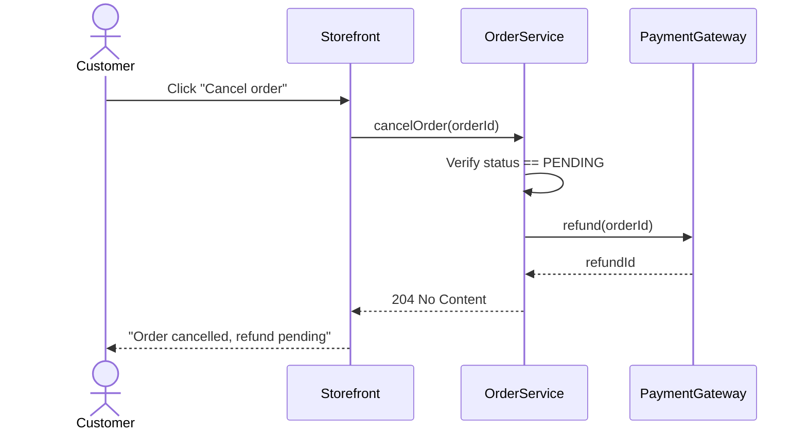

# Core Rules

## The Golden Rule

```
SPEC → TEST → IMPLEMENT → VERIFY
```

---

## Rule 1: Specification First

**Behavior changes MUST have spec BEFORE code.**

### Specs Are High-Level

Specs describe behavior, not implementation.

```markdown
# ✅ Good spec — high-level behavior
## Cancel Order
User can cancel a pending order within 24 hours.
- Order must be in PENDING status
- Refund issued automatically
- Email confirmation sent

# ❌ Bad spec — implementation details
## Cancel Order
Call OrderService.cancel() which updates the database
using JPA repository. Then call PaymentGateway.refund()
via REST API. Use @Async for email.
```

**Include:** feature purpose, actors, business rules, success/error cases. **Exclude:** class names, schemas, API impl, tech choices.

### When Specs Are NOT Required

| Situation | Example |
|-----------|---------|
| **User explicitly skips** | "Skip the spec for now" |
| **Trivial changes** | Typo fixes, log message updates |
| **Pure build/infrastructure** | Formatting, comments, dependency metadata, or CI cleanup with no behavior, deployment, routing, gate, or runtime effect |
| **Configuration** | Property changes, feature flags |
| **Refactoring** | Internal restructuring (behavior unchanged) |

**Rule of thumb:** No user-visible, runtime, deployment, or pipeline decision change → probably no spec.

### CI/CD and Infrastructure Are Behavior When They Change Decisions

Lightweight spec or ADR when work changes what system or pipeline decides:

- CI lane routing, skip logic, deploy gates, branch routing, required checks
- Cache headers, route status, redirects, metadata, sitemap/noindex
- Auth, security, rate limiting, DB migrations, event payloads, API contracts
- MCP tool schemas, tool-wire behavior, external exposure, compatibility gates

Short spec OK — MUST define inputs, outputs, compatibility, verification. Workflow/shell/config NOT exempt.

### Spec Location

```
spec/
├── features/
│   ├── README.md           # Feature index
│   └── <feature>/
│       └── <feature>.md    # One file per feature — everything in one place
├── decisions/
│   └── NNNN-<title>.md     # Architecture Decision Records
└── learnings/
    └── <category>-<topic>.md  # Key findings about the codebase
```

**One file per feature** (overview, stories, ACs, scope, verification). No separate contract/domain/flow prose files — derive from code (OpenAPI, REST Docs, SCC, DDL, types).

### REQUIRED: Feature Spec Structure

````markdown
---
feature: order-cancellation
status: planned
tests:
  - com.example.orders.OrderCancelAcceptanceTest
  - com.example.orders.OrderCancelProperties
gaps:
  - RefundTimingEdgeCaseTest
---

# Order Cancellation

## Overview
<What this feature does, in 2-3 sentences>

## Primary Actors
<Who uses this feature>

## Business Rules
<The rules that govern behavior — technology-independent>

## Error and Edge Cases
<What can go wrong and how the system handles it>

## User Stories

### US-CANCEL-1: Cancel a pending order

> As a **customer**, I want to cancel my pending order within 24 hours,
> so that I can change my mind without penalty.

```gherkin
# Tests: OrderCancelAcceptanceTest#should_cancel_pending_order
@AC-CANCEL-1
Scenario: A pending order cancelled inside the window
  Given a pending order placed less than 24 hours ago
  When the customer cancels it
  Then the order is cancelled
  And the customer is refunded in full
```

### US-CANCEL-2: Reject invalid cancellations

> As the **system**, I want to reject cancellation of shipped or expired orders,
> so that business rules are enforced.

```gherkin
# Tests: planned
@AC-CANCEL-2
Scenario: A shipped order cannot be cancelled
  Given an order that has already shipped
  When the customer tries to cancel it
  Then the cancellation is rejected
  And the customer is told the order has already shipped

# Tests: planned
@AC-CANCEL-3
Scenario: The cancellation window has expired
  Given a pending order placed more than 24 hours ago
  When the customer tries to cancel it
  Then the cancellation is rejected
  And the customer is told the cancellation window has closed
```

## Scope

### In scope
- ...

### Out of scope
- ...

## Verification
_Filled during implementation. Records which test proves each AC._
````

### REQUIRED: User Stories with Gherkin Acceptance Criteria

New functionality starts with the spec, and the spec's acceptance criteria are written as **Gherkin scenarios** — a format both humans and agents read. Write down what "done" means before any test or code exists.

- **User story** = `As a <role>, I want <goal>, so that <benefit>`
- **AC (acceptance criterion)** = one Gherkin `Scenario` = one testable, observable promise about behaviour
- **AC ID** = stable per-feature prefix tag on the scenario (`@AC-CANCEL-1`, `@AC-SNAP-3`, …)

Format — one ` ```gherkin ` block per user story, under the story's diagram:

```gherkin
# Tests: <TestClass#method> or planned
@AC-<PREFIX>-<N>
Scenario: <one observable behaviour, in business words>
  Given <the starting situation>
  When <the one action that triggers the behaviour>
  Then <the observable outcome>
  And <another observable outcome>
```

**Rules:**
- **One scenario = one promise.** Exactly one `@AC-…` tag per scenario. Happy path and each error/edge case are separate scenarios.
- **Behaviour, not code.** Business language only — no class names, endpoints, table names, HTTP codes or UI selectors. A business person must be able to read every scenario. **Test:** could it be implemented in a different tech stack from the spec alone?
- **Given / When / Then discipline.** `Given` = context, `When` = a single action, `Then` = what someone can observe. Use `And`/`But` for extra steps; `Scenario Outline` + `Examples` for data variations of the same promise.
- **Agent drafts, human approves.** The agent drafts the scenarios from the request; a human trims and confirms them before any test or code is written.
- **Linked by convention.** The AC ID goes in the test's name or tag (table below), so a search for `AC-CANCEL-1` finds both the scenario and its test. The `# Tests:` comment above the tag records which test proves it (`planned` until written).
- **IDs are stable.** Never renumber or reuse an ID; gaps are fine. To retire a promise, keep the scenario and add `@removed` next to its ID tag.
- Prefix `<PREFIX>` unique per feature — collisions flagged in `spec/features/README.md`.

These scenarios are the reference for what gets implemented. No Cucumber runner or `.feature` files are required — the acceptance tests are ordinary tests named after the AC IDs. (Teams that want executable Gherkin can extract the blocks into `.feature` files later; the format is compatible.)

Multi-AC tests OK: e.g. `AC-CANCEL-1` + `AC-PAY-3` → two `@Tag` (Java), two `pytest.mark.spec` (Python), nested `describe` (TS), or `Test_AC_CANCEL_1_AC_PAY_3` (Go).

| Language | Convention |
|----------|-----------|
| Java | `@Tag("AC-CANCEL-1")` or method name includes `_AC_CANCEL_1` |
| TypeScript | `test.describe('AC-CANCEL-1', ...)` or test name includes `AC-CANCEL-1` |
| Python | `@pytest.mark.spec("AC-CANCEL-1")` or test name includes `_ac_cancel_1` |
| Go | Test function name includes `AC_CANCEL_1` (underscore-separated) |

Multi-AC tests OK (multiple tags/decorators/describes). Cross-feature integration tests annotate every AC asserted. `verify-ac-tests.sh` satisfied if **any** project test carries that AC ID.

### REQUIRED: Mermaid sequence diagrams per user story

One [Mermaid sequence diagram](https://mermaid.js.org/syntax/sequenceDiagram.html) per user story (happy path), under story heading before the Gherkin scenarios. Actors = humans (`actor Customer`); participants = systems. Happy path only; second diagram for complex error path or bug before/after (`_bug-template.md`). Must render in GitHub MD. AC change → diagram update same PR (requirements-reviewer + index "stories without diagrams").

````markdown
### US-CANCEL-1: Cancel a pending order

> As a **customer**, I want to cancel my pending order within 24 hours,
> so that I can change my mind without penalty.



```gherkin
# Tests: OrderCancelAcceptanceTest#should_cancel_pending_order
@AC-CANCEL-1
Scenario: A pending order cancelled inside the window
  Given a pending order placed less than 24 hours ago
  When the customer cancels it
  Then the order is cancelled
  And the customer is refunded in full
```
````

### REQUIRED: Spec-Test Traceability

Frontmatter: `tests:` (existing classes), `gaps:` (planned). `status: draft` or `status: planned` exempt from test requirements.

Run both:
- `./scripts/verify-spec-tests.sh` — `tests:` classes exist
- `./scripts/verify-ac-tests.sh` — each AC ID has annotated test

**Valid `status`:** `draft`, `planned`, `in-progress`, `implemented`, `deprecated`

### What Makes a Good Spec

Answers: what, who, rules, what can go wrong. **Test:** implementable in different tech from spec alone?

---

## Rule 2: Test First (ATDD + TDD)

**Acceptance test BEFORE implementation.**

- **ATDD outer:** one acceptance test per AC, real infra (Testcontainers), business-readable, no mocks as primary proof
- **TDD inner:** minimal code to pass

MUST fail first (RED) → minimal pass (GREEN). Property/mutation tests complement, don't replace. Assert observable I/O, not copied impl logic. No test-first evidence → not ready for senior review.

---

## Rule 3: User Override

User may override spec/test reqs ("Skip the spec", "Don't write tests", "Just implement it", "Trivial change"). Override = this task only; note what skipped; never suggest skipping unprompted.

```
User: "Add Docker support for the app"

Agent: "Adding Dockerfile and docker-compose.yml.
(No spec needed — infrastructure/build change)"
```

```
User: "Add order cancellation feature, skip the spec"

Agent: "Implementing without spec as requested.

Note: Consider adding spec at `spec/features/orders/cancel.md`
for documentation. Without it, behavior won't be preserved
in future rewrites."
```

---

## Workflow

```
0. MANDATORY: Read spec/learnings/README.md, pull entries relevant
   to modules you're about to touch. Apply known gotchas.
1. Is this a behavior change?
   ├── NO (build/config/refactor) → Skip spec, proceed
   └── YES → Does spec exist?
              ├── NO  → Create high-level spec with AC IDs first
              └── YES → Continue
2. For each AC:
   a. Write acceptance test verifying business intent (ATDD, must fail)
   b. Implement minimal code to pass (TDD inner loop)
   c. CHECKPOINT: re-read plan, verify AC is green, self-correct if drifted
3. After all ACs green:
   a. Run `verify-spec-tests.sh` (structural — `tests:` classes exist)
   b. Run `verify-ac-tests.sh` (per-AC annotation matching)
   c. Run `verify-mermaid.sh` (sequence diagrams parse cleanly)
   d. Security review
   e. 3-agent pre-commit review
4. Update spec/learnings/ if key findings were discovered
```

---

## HARD STOP: Spec-First Enforcement

Before ANY production source:

1. **STOP.** Spec for this behavior?
2. No spec → create/update spec FIRST; show user
3. Spec exists → failing test FIRST
4. Then production code

**Bug report:** spec expected behavior → regression test (RED) → fix (GREEN). Not: curl → fix → curl → commit.

**Hooks:** `hooks/spec-first-check.sh` (PreToolUse) warns on source without spec. `hooks/triage-check.sh` (Stop) runs 3-agent triage at session end.

---

## Principles

| Principle | Meaning |
|-----------|---------|
| **KISS** | Simplest solution wins |
| **YAGNI** | Don't build what you don't need |
| **DRY** | Don't repeat yourself |

**Specs are permanent. Code is temporary.**

> Rationale (Why/Calibration/Cross-refs): `docs/rule-rationale/core.md`
