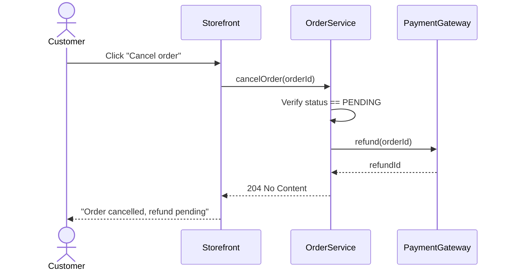

# claude-code-starter

[](https://github.com/nasalp/claude-code-starter/actions/workflows/ci.yml)

A production-grade workflow system for [Claude Code](https://docs.anthropic.com/en/docs/claude-code) — enforcing TDD, multi-agent consensus review, and security gates across projects and languages.

Inside the docs and scripts the harness is called **ai-rules** (e.g. the `AI_RULES_REPO` variable points at your clone of this repo).

All content in this repo is **owned** — there is no upstream subtree. Officially supported languages: typescript, web, java, php, python (plus the universal `common/` layer). Other-language directories have been removed; add a new one only when one of your projects starts using that language.

## Who is this for

This repo is the **canonical harness** that all your projects share —
one place to update rules, hooks, slash commands, agents, and skills,
and every consumer repo picks up the change via symlink.

- **If you are a business person or product owner**, the parts you touch
  are user stories and acceptance criteria. You write what the system
  should do in plain language; the agent drafts a feature spec with a
  Mermaid sequence diagram and acceptance criteria written as Gherkin
  scenarios (Given/When/Then); you trim and confirm them; engineering takes it from there. See the
  [How We Work → For Business Owners](#for-business-owners) section
  below for the full flow.
- **If you are an engineer**, you run `./setup.sh` once on your laptop,
  open Claude Code in any consumer repo, and the harness is in scope:
  hooks fire on edits, slash commands drive the ATDD/TDD loop, three
  reviewer agents must reach unanimous APPROVE before commit, and the
  meta-harness promotes patterns up to canonical rules when two
  projects independently re-derive them. See the
  [Day-to-day developer flow](#day-to-day-developer-flow) and
  [Meta-harness](#meta-harness--promote-learnings-and-retract-rule)
  sections below.

The harness has three layers:

1. **General rules** — `.claude/rules/` loaded into every Claude Code
   session, plus warnings-only hooks in `.claude/hooks/` and slash
   commands in `.claude/commands/`. The dev-facing daily-use surface.
2. **Meta-harness** — `/promote-learnings` and `/retract-rule` close
   the loop from "consumer projects converge on the same pattern" to
   "canonical rule shared with all your projects" and back. Backed by
   testable scripts under `scripts/promote-learnings/` and
   `scripts/retract-rule/`.
3. **User stories and acceptance criteria** — `spec/features/<slug>/<slug>.md`
   is the canonical home for every feature spec. Stories and ACs are
   the contract between business and engineering, with Mermaid
   sequence diagrams as the visual layer and three verifiers
   (`verify-spec-tests.sh`, `verify-ac-tests.sh`, `verify-mermaid.sh`)
   asserting traceability before commit.

## Architecture

```
.claude/
├── rules/              # Development standards (all owned)
│   ├── common/         #   Language-agnostic principles
│   ├── java-spring/    #   Spring Boot specifics
│   ├── 22+ top-level   #   Domain rules (testing, security, API, etc.)
│   ├── typescript/     #   TypeScript-specific
│   ├── web/            #   Web/frontend-specific
│   ├── java/           #   Java-specific
│   ├── php/            #   PHP-specific
│   └── python/         #   Python-specific
│
├── agents/             # Sub-agents (40+) — all owned
│   ├── implementer.md          # TDD GREEN phase — minimal code
│   ├── adversary.md            # Adversarial reviewer — breaks impl
│   └── requirements-reviewer.md # Pre-commit auditor — prod checklist v10
│
├── commands/           # Slash commands (80+) — all owned
├── hooks/              # Automation triggers (shell + Node hook scripts)
├── skills/             # Deep reference guides — see .claude/skills/INDEX.md (auto-regenerated)
├── checklists/         # Quality gates
├── contexts/           # Dev/review/research contexts
├── workflows/          # Feature/bugfix/planning workflows
└── scripts/            # Helper scripts

CLAUDE.md               # Project context template
AGENTS.md               # Agent orchestration preferences

spec/learnings/         # Living knowledge base of cross-project findings
spec/decisions/         # ADRs

```

## How It Works

### The Core Loop

```
SPEC → TEST → IMPLEMENT → VERIFY
```

Every feature goes through this pipeline, enforced by hooks and agents:

1. **Describe** the feature in plain language (or run `/user:feature`)
2. Claude generates a **FEATURE.md** with acceptance criteria and TDD plan
3. **Failing test first** — the `require-test-first.sh` hook blocks production code edits until a test exists
4. **Multi-agent TDD cycle** — implementer writes minimal code, adversary tries to break it, in parallel
5. **Pre-commit review** — all 3 agents vote APPROVE/REJECT against a 9-section production readiness checklist
6. **Commit only after unanimous approval** (or explicit user override)

### Senior Review Gate

Before a PR is sent to a senior code owner, agents must apply
[`.claude/rules-corpus/senior-review-gates.md`](.claude/rules-corpus/senior-review-gates.md).
Green CI is not enough. The PR needs a spec or ADR, test-first evidence,
behavioral tests that cover the input/output matrix, compatibility proof,
and maintainable code shape.

### Multi-Agent Consensus

Three custom agents work together on every non-trivial feature:

| Agent | Model | Role |
|-------|-------|------|
| **Implementer** | Sonnet | GREEN phase only. Writes minimal code to pass the failing test. Never modifies tests. |
| **Adversary** | Sonnet | Tries to break the implementation. Writes failing tests for edge cases, security, and boundary conditions. |
| **Requirements Reviewer** | Opus | Pre-commit auditor. Checks every acceptance criterion + full production readiness checklist. Votes APPROVE or REJECT. |

The implementer and adversary run **in parallel** per TDD cycle. Before commit, all three review and must reach **unanimous APPROVE**. Max 3 review rounds — then the user decides.

### Change Tiers

Not every change needs the full triage:

| Tier | Criteria | Review Level |
|------|----------|-------------|
| Trivial | Config, docs, deps, migrations, 1-file fix | No triage |
| Standard | Single feature, <400 lines | Implementer + adversary |
| Critical | Security, auth, payments, public API | Full 3-agent triage |

### Production Readiness Checklist (v10)

The requirements-reviewer evaluates 9 sections. Sections 1-7 are **MUST-HAVE** (any failure = REJECT). Sections 8-9 are **SHOULD-HAVE** (flagged but don't block).

| # | Section | Key Checks |
|---|---------|------------|
| 1 | Functional correctness | All acceptance criteria met, no regressions |
| 2 | Test coverage & quality | 6 test types required, 90% line/branch/mutation, no tautological assertions |
| 3 | Security | Password hashing, auth/authz, API access matrix, no secrets in code, CSRF, CORS |
| 4 | Data integrity | Migration safety, idempotency, DB-level constraints |
| 5 | Design & structure | No breaking API changes, no circular deps, single responsibility |
| 6 | Reliability | Timeouts, circuit breakers, bounded retries, bounded resource pools |
| 7 | Concurrency | No unprotected shared mutable state |
| 8 | Observability | Metrics, structured logging, tracing *(SHOULD-HAVE)* |
| 9 | Operational readiness | Health checks, feature flags, graceful shutdown *(SHOULD-HAVE)* |

### Required Test Types

Every feature requires all 6:

1. **Unit tests** — isolated, no external dependencies
2. **Integration tests** — real boundaries (DB, HTTP, queues)
3. **Contract tests** — API shape, status codes, error format
4. **Property-based tests** — domain invariants, roundtrips
5. **Mutation testing** — kill rate >= 90%
6. **Static analysis** — linter + type checker + security scanner, zero violations

### Hook Scripts

All hooks use `python3` for JSON parsing (not `jq`), work on macOS and
Linux. **Every hook is warnings-only** — exit 0
plus stderr message; nothing blocks a tool call. The `Day-to-day
developer flow` section below has the full table.

| Hook | Trigger | Purpose |
|------|---------|---------|
| `require-test-first.sh` | PreToolUse (Write/Edit) | Warns when production code is edited without a test file. Allowlist for DTOs, configs, exceptions, enums. Covers Java, Kotlin, Scala, Groovy, TS, JS, MJS, CJS, JSX, TSX, Vue, Svelte, PHP, Python, Go, Rust. |
| `auto-test.sh` | PostToolUse (async) | Runs relevant tests after edits. Debounced (30s), concurrency-guarded, auto-detects build tool. |
| `verify-before-stop.sh` | Stop | Runs full test suite before session ends. Warns on failure (`SKIP_VERIFY_STOP=true` to silence). |
| `detect-structure-change.sh` | Stop | Hashes directory structure, detects drift, suggests `/user:refresh-project`. |
| `spec-first-check.sh` | PreToolUse (Write/Edit) | Warns when production files modified without spec changes. |
| `check-rules-staleness.sh` | SessionStart | Warns if `$AI_RULES_REPO/.claude/rules/` has not been updated in 14 days. |
| `verify-subagent-work.sh` | SubagentStop | Inspects subagent transcript via real `tool_use` evidence (not text mentions) and warns if production source was edited without a corresponding test edit. |

## Quick Start

### 1. Clone and run setup

Prerequisites: [Claude Code](https://docs.anthropic.com/en/docs/claude-code), git, bash, Node 22+, Python 3, jq.

```bash
export AI_RULES_REPO="$HOME/repo/claude-code-starter"   # pick any path you like
git clone https://github.com/nasalp/claude-code-starter.git "$AI_RULES_REPO"
cd "$AI_RULES_REPO"
./setup.sh --dry-run    # preview what will change
./setup.sh
```

`setup.sh` is the single idempotent entry point. It:

- Symlinks the repo's `.claude/` tree (rules, agents, commands, skills, hooks,
  workflows, …) plus `CLAUDE.md` and `AGENTS.md` into `~/.claude/`.
- Installs `~/.claude/settings.json` from the template (hook wiring). If you
  already have a different `settings.json`, it is backed up to
  `settings.json.backup-<timestamp>` first.

Re-running `setup.sh` on an already-installed machine changes nothing and
reports `ok` for every entry. Stale symlinks are refreshed; existing non-empty
directories and regular files at managed paths are never overwritten (setup
stops and tells you what to move aside). Use `--no-hooks` to leave
`settings.json` alone.

> **Note:** the settings template enables `defaultMode: acceptEdits` and
> `skipDangerousModePermissionPrompt`. Review `.claude/settings.json.template`
> before running setup if you prefer stricter defaults.

To undo everything: `./uninstall.sh` (removes the symlinks that point into this
repo and restores the most recent settings backup). Both scripts accept
`--dry-run`.

Persist `AI_RULES_REPO` in your shell profile so `/promote-learnings`,
`/retract-rule`, and other scripts can find the checkout:

```bash
# Append to ~/.zshrc or ~/.bashrc
export AI_RULES_REPO="$HOME/repo/claude-code-starter"
```

### 2. Initialize a project

```bash
cd /path/to/your/project
# In Claude Code:
/user:init-project
```

This creates `CLAUDE.md`, `.claudeignore`, `.claude/settings.json`, and `.claude/hooks/` in your project.

### 3. Start working

Just describe what you want to build:

```
I want to add an order cancellation endpoint. Users can cancel pending
orders within 24 hours. Refund is issued automatically.
```

Claude recognizes this as a feature kickoff and activates the full workflow — FEATURE.md, TDD plan, multi-agent loop.

Or use the command directly:

```
/user:feature Add order cancellation with automatic refunds
```

### 4. Audit your setup

```
/user:audit              # Check global + project config
/user:audit-skills       # Evaluate skills against Anthropic's checklist
```

## Day-to-day developer flow

This is what running Claude Code in any consumer repo looks like once
`setup.sh` has been run.

**On every session start.** The `SessionStart` hook fires
`check-rules-staleness.sh` and warns if `$AI_RULES_REPO/.claude/rules/`
hasn't been updated in 14 days (configurable via `STALENESS_DAYS`,
silenceable with `SKIP_STALENESS=true`). That's the "git pull on
ai-rules now" nudge so the linked harness doesn't drift silently.

**While you work.** Hooks fire automatically:

| Trigger | Hook | What it does |
|---|---|---|
| `PreToolUse` Edit/Write | `spec-first-check.sh` | Warns if you edit production source without touching `spec/`. |
| `PreToolUse` Edit/Write | `require-test-first.sh` | Warns if you edit production source without a corresponding test file. Covers Java, Kotlin, Scala, Groovy, TS, JS, MJS, CJS, JSX, TSX, Vue, Svelte, PHP, Python, Go, Rust. |
| `PreToolUse` Bash | `block-dev-server-outside-tmux.sh` | Warns when `npm/pnpm/yarn run dev` launches outside tmux (logs lost on shell exit). |
| `PreToolUse` Bash | `tmux-reminder.sh` | Suggests tmux for long-running commands. |
| `PreToolUse` Bash | `git-push-reminder.sh` | One-liner before `git push`. |
| `PostToolUse` Bash | `notify-pr-created.sh` | After `gh pr create`, surfaces the PR URL and a `gh pr view` review command. |
| `SubagentStop` | `verify-subagent-work.sh` | Inspects the subagent's transcript via real `tool_use` evidence (not text mentions) and warns if production source was edited without a corresponding test edit. |
| `Stop` | `triage-check.sh`, `verify-before-stop.sh` | End-of-session triage and full-test-suite check. |

**Every hook is warnings-only.** Every script exits 0 and writes
warnings to stderr. None of them blocks a tool call. The "warn, don't
break" rule is documented at the top of every hook and verified by
BATS.

**Slash commands** in `.claude/commands/` are agent instructions. The
deterministic parts (file moves, ledger appends, preflight checks,
state-hash computation, expiry rotation) are extracted into
`scripts/<command>/*.sh` so they're independently BATS-testable; the
agent only orchestrates them with judgment.

**Spec → Test → Implement → Verify.** Every behavior change goes
through this loop. Specs live at `spec/features/<feature>/<feature>.md`
in the consumer project. Learnings (cross-project findings) live at
`spec/learnings/<category>-<topic>.md` and carry a `topic:` from the
controlled vocabulary in `spec/promotion-topics.yaml` so the
meta-harness can detect when two projects independently re-derive the
same pattern.

**Configuration env vars used in the day-to-day flow:**

| Variable | Effect |
|---|---|
| `AI_RULES_REPO` | Path to the ai-rules clone. Hooks resolve it from `${CLAUDE_PLUGIN_ROOT}` → script-relative → `$HOME/.claude` if unset. |
| `STALENESS_DAYS` | Days before the staleness hook warns (default 14). |
| `SKIP_STALENESS` | `true` silences the staleness hook. |
| `SPEC_BYPASS` | `true` silences the spec-first / require-test-first warnings for the current operation. |
| `SKIP_VERIFY_STOP` | `true` silences `verify-before-stop`. |

## Meta-harness — `/promote-learnings` and `/retract-rule`

The meta-harness is the closed loop that turns per-project learnings
into shared rules and retracts rules that turned out to be wrong.

### Promotion: `/promote-learnings`

Run from a folder containing your project repos. The command (backed
by scripts under `scripts/promote-learnings/`) does:

1. **Preflight** (`preflight.sh`) — validates `AI_RULES_REPO` and
   `PROJECTS_ROOT`, honours the kill-switch file
   `$AI_RULES_REPO/spec/promotion-disabled`, exits cleanly if a draft
   `[promotion]` PR is already open, and computes a deterministic
   per-project state-hash. If the hash matches the last successful
   run, the command short-circuits (no-op). The preflight also calls
   `rotate-expired-rejections.sh` so the 90-day expiry promise on the
   rejection ledger is enforced by code on every run.
2. **Discovery** (`discover-projects.sh`) — enumerates qualifying
   project repos under `$PROJECTS_ROOT` (have `.git` and either
   `spec/learnings/` or `.claude/rules/`); excludes the ai-rules
   checkout itself even if nested.
3. **Convergence detection** — a candidate qualifies if (a) the same
   `topic:` (from `spec/promotion-topics.yaml`) appears in 2+
   projects, (b) the source commits are by different authors, (c)
   they're at least 5 calendar days apart, (d) the rule isn't already
   upstream, (e) it isn't in the rejection ledger within the 90-day
   window.
4. **Haiku triage** prunes ~70% of candidates cheaply
   (PROMOTE / REJECT / HUMAN).
5. **3-agent consensus** spawns Architect, Field Engineer, and
   Adversary agents in parallel. Each agent must produce **structured
   evidence** before voting:
   - Architect: existing-rule overlap citation, mechanism-vs-policy
     classification, generalization test (must name 2 stacks).
   - Field Engineer: retroactive-applicability test against the
     source incident, effort-to-comply estimate, drift survivability.
   - Adversary: a named false-positive stack from `$PROJECTS_ROOT/*`,
     scope-inflation check, independent existing-rule overlap.

   The Adversary REJECT is binding even if the other two APPROVE.
   The structured-evidence output is copied verbatim into the PR body
   so a human reviewer can audit each check.
6. **Rejection ledger** — on any REJECT, `append-rejection.sh` writes
   a structured entry to `spec/decisions/rejected-promotions.md` with
   reviewer, reason, re-evaluation date, and the cited evidence.
7. **Heartbeat** (`write-heartbeat.sh`) writes one line per run to
   `spec/promotion-log/<date>.md`. If you don't see entries for two
   weeks, the loop is broken.
8. **Compliance check** (`check-compliance.sh`) — reads optional
   `<rule>.compliance.regex` sidecars next to each live rule and
   greps each consumer's **production source** (`src/main/`, `lib/`,
   top-level `src/` minus `test/`) for forbidden literals. Heartbeat
   line: `<timestamp> | compliance: <N> rules / <N> clean / <N> violated`.
   Test code is never scanned, so legitimate placeholder secrets and
   `Thread.sleep` in setup do not false-positive. Adoption tracking
   ("did consumer X wire ArchUnit for rule Y?") is intentionally NOT
   done via grep — that's too fragile against multi-line wraps and
   reformatting; consumer CI status is the right adoption signal.

### Retraction: `/retract-rule`

Inverse flow, backed by `scripts/retract-rule/`:

1. **Preflight** (`preflight.sh`) — validates env, resolves the
   target (relative path, bare name, or skill directory), no-ops if
   already deprecated, refuses to run on a dirty tree.
2. **Move-to-deprecated** (`move-to-deprecated.sh`) — **transactional**.
   Builds a plan (rule + sibling `.compliance.regex` sidecars),
   executes each `git mv` recording a COMPLETED stack, on first
   failure walks the stack in reverse to revert. Every directory
   created by the run is tracked and `rmdir`'d on rollback (refuses
   non-empty so pre-existing dirs survive). Rollback failures are
   surfaced explicitly with a `git status` recovery hint. The result
   is two states only: the retraction landed cleanly, OR nothing
   changed.
3. **Deprecation banner** is prepended to the moved file with reason,
   retracted-from sha, and a pointer to the rejection ledger.
4. **Rejection ledger** — same `append-rejection.sh` script as
   `/promote-learnings`, single source of truth.
5. **Inbound references** (`find-inbound-refs.sh`) — greps live trees
   (skills/, commands/, agents/, rules/, docs/, excluding
   `_deprecated/`) for the retracted name; the list goes into the PR
   body as a follow-up checklist.
6. **Draft PR** opens with the full audit trail.

### Compliance sidecars (optional, per rule)

A rule may carry `<rule>.compliance.regex` declaring literal forbidden
patterns (one per line, `#` for comments). The compliance runner is
for **trend visibility**, not enforcement: real enforcement lives in
each consumer's build (ArchUnit, ESLint, Spotless, SpotBugs,
Checkstyle). The harness verifies trends; it doesn't reinvent
enforcers. Documented in `docs/compliance-regex-howto.md`.

### What this harness explicitly does NOT do

- Re-implement build-time enforcement.
- Run on a schedule (cron is a separate decision).
- Auto-merge PRs (every promotion / retraction is a draft).
- Trigger from project-side hooks.
- Track adoption via grep.
- Block tool calls (every hook is warnings-only).
- Bake user-specific paths into anything (everything goes through
  `AI_RULES_REPO` / `PROJECTS_ROOT` / `${CLAUDE_PLUGIN_ROOT}`).

## How We Work

All your projects follow the same workflow. Business defines WHAT, agents implement HOW, verification ensures it's DONE.

### For Business Owners

You don't need to know git, CLI, or any commands. Open a Claude conversation and describe what you want:

> "Our customers are complaining they can't cancel orders.
> I want them to cancel pending orders within 24 hours
> and get an automatic refund."

The agent will:
1. **Draft user stories** with acceptance criteria in a single spec file
2. **Ask you to confirm** — add, remove, or refine stories and criteria
3. **Save the spec** as one file at `spec/features/<feature>/<feature>.md`

That's it. The development team takes it from there.

#### What a good feature spec looks like

One file per feature at `spec/features/<feature>/<feature>.md`. Each
user story has a **Mermaid sequence diagram** of the happy-path flow,
followed by its acceptance criteria written as **Gherkin scenarios** —
one `Scenario` per observable promise, tagged with a stable AC ID. The
diagram lets a business person see the shape of the flow in three
seconds; the scenarios fill in the testable details.

````markdown
## User Stories

### US-CANCEL-1: Cancel a pending order

> As a **customer**, I want to cancel my pending order within 24 hours,
> so that I can change my mind without penalty.



```gherkin
# Tests: OrderCancelAcceptanceTest#should_cancel_pending_order
@AC-CANCEL-1
Scenario: A pending order cancelled inside the window
  Given a pending order placed less than 24 hours ago
  When the customer cancels it
  Then the order is cancelled
  And the customer is refunded in full

# Tests: OrderCancelAcceptanceTest#should_reject_shipped_order
@AC-CANCEL-2
Scenario: A shipped order cannot be cancelled
  Given an order that has already shipped
  When the customer tries to cancel it
  Then the cancellation is rejected
  And the customer is told the order has already shipped
```
````

Conventions, all enforced by tooling so the spec can never drift:

| Rule | Enforced by |
|------|-------------|
| Each AC is one Gherkin `Scenario`, tagged with an ID in the prefix form `@AC-<PREFIX>-N` (e.g. `@AC-CANCEL-1`) — never bare `AC1`. | `core.md` rule + per-language test annotation table |
| Each user story has a Mermaid sequence diagram showing the happy-path flow. | `scripts/verify-mermaid.sh` (catches missing `sequenceDiagram` headers, unbalanced loop/end blocks, malformed arrows, unknown statements) |
| Every AC ID has at least one test annotated with that exact ID using the per-language convention (Java `@Tag`, TS `test.describe`, Python `@pytest.mark.spec`, Go function-name fragment). | `scripts/verify-ac-tests.sh` (per-AC traceability) |
| The spec's `tests:` frontmatter classes exist on disk and are not `@Disabled`. | `scripts/verify-spec-tests.sh` (structural traceability) |
| The `<PREFIX>` is unique across all features in the project. | `scripts/generate-features-index.py` (auto-flags collisions in `spec/features/README.md`) |
| The features index is auto-generated from live frontmatter — never hand-edited. | `scripts/generate-features-index.py` |

A business person can read every user story, every Mermaid diagram, and
every scenario without seeing implementation details. Scenarios
describe WHAT, never HOW (no class names, endpoints, tables, HTTP codes
or UI selectors). The full canonical convention lives at
`.claude/rules/core.md` and a starter template at
`spec/features/_template.md`. Bug fixes use a different shape with
three ACs (reproduction → fix → regression-prevention) and two
diagrams (buggy flow vs fixed flow); the template is at
`spec/features/_bug-template.md`.

### For Developers

Describe what you want to implement. The agent handles the rest:

> "Implement the order cancellation feature"

The agent will:
1. **Read learnings** -- check past mistakes for this module
2. **Read the spec** -- find the acceptance criteria (Gherkin scenarios tagged `@AC-<PREFIX>-N`)
3. **ATDD loop per AC**:
   - Write an acceptance test that verifies the business outcome
   - Tests use real infrastructure (Testcontainers), no mocks
   - Implement minimal code to pass the test
   - Adversary agent attacks edge cases
4. **Verify** -- traceability, coverage, mutation testing
5. **3-agent pre-commit review** -- all must approve
6. **Commit**

You never need to remember commands. The agent detects your intent.

### The ATDD + TDD Loop

```
For each acceptance criterion:

  ATDD outer loop (business intent):
    Write acceptance test -> must FAIL (RED)
    |
    TDD inner loop (implementation):
      Implement minimal code -> must PASS (GREEN)
      Adversary attacks -> repeat if broken
    |
    AC verified -> property-based tests + mutation testing
    |
    -- CHECKPOINT --
    Re-read plan. Verify progress. Self-correct if drifted.

After all ACs green:
  Independent Auditor (separate worktree, fresh build)
  3-agent pre-commit review
  Commit only after unanimous APPROVE
```

### 2-Tier Trust Model

Agents can forget, hallucinate, or cut corners. We prevent this with:

| Tier | What | Why |
|------|------|-----|
| **Builder + Checkpoints** | After each AC, re-read the plan and verify progress | Catches drift and forgetting mid-session |
| **Independent Auditor** | Runs `./mvnw clean verify` in a separate worktree | Catches lies -- the Builder can't fake a fresh build |

The Auditor only sees the spec and the code. It does NOT see the Builder's reasoning. This isolation is what makes it trustworthy.

### How Agents Work Together

Three custom agents collaborate on every feature, with distinct roles and trust boundaries:

```
Business Owner describes feature
        |
        v
  +------------------+
  |   /feature cmd   |  Generates spec with AC IDs
  +------------------+  Shows to user for confirmation
        |
        v
  +-----------+     +-----------+
  |Implementer| <-> | Adversary |   Run IN PARALLEL per AC
  +-----------+     +-----------+
  | Writes        | Tries to break
  | minimal code  | the implementation
  | to pass the   | Writes additional
  | acceptance    | failing tests
  | test (GREEN)  | for edge cases
  +-----------+     +-----------+
        |               |
        v               v
  +-------------------------------+
  |     CHECKPOINT (after each AC)|
  | Re-read plan, verify progress |
  | Self-correct if drifted       |
  +-------------------------------+
        |
        v  (after all ACs green)
  +-------------------------------+
  |     Independent Auditor       |
  | Separate worktree, fresh build|
  | Sees only spec + code, not    |
  | Builder's reasoning           |
  +-------------------------------+
        |
        v
  +-------------------------------+
  | 3-Agent Pre-Commit Review     |
  +-------------------------------+
  | Requirements Reviewer (Opus)  |
  |   Full checklist v10 + AC     |
  |   traceability check          |
  | Adversary (Sonnet)            |
  |   Final sweep for missed      |
  |   edge cases                  |
  | Implementer (Sonnet)          |
  |   Confirms all tests pass     |
  +-------------------------------+
        |
        v
  All 3 APPROVE -> Commit
  Any REJECT -> Fix + re-review (max 3 rounds)
```

**Key trust boundaries:**
- The Implementer and Adversary run in parallel but with opposing goals
- The Auditor is isolated -- it has NO access to the Builder's conversation context
- The Requirements Reviewer uses the Opus model for deepest reasoning
- Checkpoints between ACs prevent drift within a single session
- Max 3 adversary rounds per AC and max 3 review rounds prevent infinite loops

### Quality Bar (all projects)

| Requirement | Target |
|-------------|--------|
| Line + branch coverage | 90% |
| Mutation testing (PITest) | 80%+ kill rate |
| Property-based tests (jqwik) | Domain invariants covered |
| Acceptance tests | Verify business outcomes, not stubs |
| Mocking | Never as primary AC verification |
| Architecture | Package-per-feature |

## Running the tests

```bash
bash tests/run.sh                      # everything
bash tests/run.sh tests/test-setup.sh  # one suite
```

| Suite | What it proves |
|-------|----------------|
| `test-hygiene.sh` | No CRLF line endings, every `.sh` is executable, all shell/JS/Python parses, the settings template renders to valid JSON and every hook it references exists |
| `test-setup.sh` | `setup.sh` / `uninstall.sh` against a throwaway `HOME`: dry run changes nothing, settings are backed up and restored, re-runs are no-ops, user folders are never overwritten |
| `test-hooks.sh` | Every wired hook runs and exits 0 on a sample payload (hooks warn, never break) |
| `test-verify-ac-tests.sh` | Gherkin acceptance criteria are detected; `@removed` scenarios, comments and non-Gherkin code are ignored |
| `test-rules-index.sh` | `.claude/rules/INDEX.md` matches a fresh generation (needs `yq`) |

CI (`.github/workflows/ci.yml`) runs the same suite on Ubuntu and macOS for
every push and pull request, plus ShellCheck on the installer and tests.

## Scripts Reference

| Script | Purpose |
|--------|---------|
| `setup.sh` | Install: symlink `.claude/`, `CLAUDE.md`, `AGENTS.md` into `~/.claude/` and render `settings.json` |
| `uninstall.sh` | Remove those symlinks and restore the previous `settings.json` |
| `scripts/gen-rules-index.sh` | Regenerate `.claude/rules/INDEX.md` after adding or changing rules |
| `scripts/check-rules-index.sh` | CI gate: fail if `INDEX.md` is stale |
| `scripts/verify-spec-tests.sh`, `verify-ac-tests.sh`, `verify-mermaid.sh` | Optional spec ↔ test traceability checks |
| `scripts/generate-features-index.py` | Regenerate `spec/features/README.md` (feature list, AC counts, prefix collisions) |
| `scripts/promote-learnings/`, `scripts/retract-rule/` | Back-end for `/promote-learnings` and `/retract-rule` |
| `tests/run.sh` | Run the test suite (same as CI) |

## Commands Reference

| Command | Purpose |
|---------|---------|
| `/user:feature` | Start a feature or bug fix with multi-agent TDD workflow |
| `/user:init-project` | One-time project setup (CLAUDE.md, hooks, settings) |
| `/user:refresh-project` | Sync config when project structure changes |
| `/user:audit` | Check global and project configuration health |
| `/user:audit-skills` | Evaluate skills against Anthropic's official checklist |
| `/user:tag-rules` | Add frontmatter tags to untagged rule files |
| `/build`, `/test`, `/review`, `/tdd`, `/plan`, `/adr`, `/verify` | Workflow commands |
| `/code-review`, `/security-review`, `/save-session`, `/resume-session` | Review & session commands |

See `.claude/commands/` for the full list (80+).

## License

MIT — see [LICENSE](LICENSE). Parts of `.claude/` are derived from
[Everything Claude Code](https://github.com/affaan-m/ECC) (MIT); see
[NOTICE.md](NOTICE.md).
